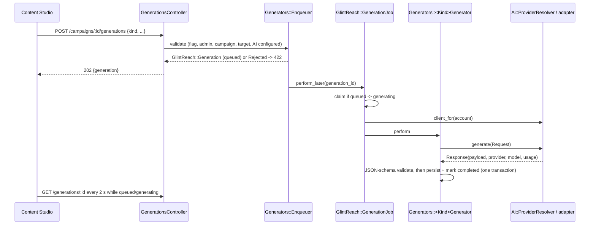

# GlintReach AI layer (Phase 04)

Turns a saved campaign brief and the account brand profile into a strategy, a content plan, content
items, platform variants, rewrites and hashtag/CTA suggestions. Publishing and scheduling are out of scope.

## 1. Flow



## 2. Components

| Piece | File | Responsibility |
| --- | --- | --- |
| Provider-neutral contract | `app/services/glint_reach/ai/request.rb`, `response.rb` | `Request(system_prompt, user_content, schema, feature)` → `Response(payload, provider, model, usage)` |
| Errors | `app/services/glint_reach/ai/error.rb`, `error/*.rb` | Vendor-independent taxonomy (table below) |
| Resolver | `app/services/glint_reach/ai/provider_resolver.rb` | Picks model via `Llm::FeatureRouter` (`config/llm.yml` feature `glint_reach_generation`), checks a real credential exists, returns the adapter. **No mock fallback.** |
| OpenAI adapter | `app/services/glint_reach/ai/adapters/ruby_llm.rb` | The only file that knows `ruby_llm`. Structured output, 60 s timeout, 1 transport retry, maps vendor errors |
| Context | `app/services/glint_reach/generators/context_builder.rb` | Whitelisted brand/brief fields as JSON in tagged blocks; tag strings stripped from values |
| Schemas | `app/services/glint_reach/generators/schemas/*_schema.rb` | Output contract per kind (Schematist), sent to the provider **and** re-validated server-side |
| Generators | `app/services/glint_reach/generators/*_generator.rb` | One per kind; persist only valid output |
| Enqueuer | `app/services/glint_reach/generators/enqueuer.rb` | Request validation, duplicate/stale handling, queuing |
| Job | `app/jobs/glint_reach/generation_job.rb` | Idempotent claim, retries for transient errors, stores failures |
| Record | `app/models/glint_reach/generation.rb` | Status, options, result summary, usage, error |

## 3. Generation kinds

| kind | Target | Writes |
| --- | --- | --- |
| `strategy` | campaign | `campaigns.strategy` (jsonb: positioning, key_messages, content_pillars, channel_approach) |
| `content_plan` | campaign (`count` 1–10, default 5) | New `draft` content items (never edits existing ones) |
| `content_item` | campaign | One new `draft` content item |
| `variants` | content item (`platforms[]`, defaults to brief channels) | Creates/overwrites **draft** variants; `ready` variants are skipped and reported in `result.skipped_platforms` |
| `rewrite` | draft variant (`instruction` ≤ 500) | Overwrites body/CTA/hashtags; `result.previous_body` keeps the old text |
| `suggestions` | variant | Nothing; hashtags and CTAs returned in `result` for the user to apply |

"Approved" = variant status `ready`. Rewrites and regeneration are refused for it both when queuing
and again inside the write transaction (row lock), so approving during a running generation is safe.
Generated items/variants carry `generation_id` for provenance.

## 4. Errors

| code | Retried | Meaning / user message source (`errors.glint_reach.ai.*`) |
| --- | --- | --- |
| `not_configured` | no | No key for the resolved provider, or key rejected (401/403/model not found) |
| `rate_limited` | yes (3 attempts, backoff) | Provider throttling |
| `unavailable` | yes | Timeout, 5xx, overload, network |
| `quota_exceeded` | no | Provider billing (402) |
| `refused` | no | Content filter or model refusal |
| `invalid_response` | no | Empty, malformed JSON, non-object, schema mismatch, or model validation failure |
| `input_too_large` | no | Context window exceeded |
| `invalid_request` | no | Provider 400 |
| `campaign_locked`, `variant_approved`, `content_item_missing` | no | Target became read-only after queuing |
| `glint_reach_disabled` | no | Flag turned off before the job ran |
| `timeout` | no | Stuck in `generating` > 10 min; expired on the next request for that target |
| `unexpected` | no | Any other exception (also sent to `ChatwootExceptionTracker`) |

A failed generation never writes content: output is validated before the transaction, and the
completed status is set inside the same transaction as the write.

## 5. Usage and cost metadata

Stored on `glint_reach_generations`: `provider`, `model`, `input_tokens`, `output_tokens`,
`credit_multiplier` (from `config/llm.yml`), `started_at`, `completed_at`, `requested_by_id`.
Prompts, brand text and API keys are **not** stored. `options` holds only request parameters
(platforms, count, rewrite instruction). Generation does not consume the Captain response quota.

## 6. Enabling AI

Set `CAPTAIN_OPEN_AI_API_KEY` (and optionally `CAPTAIN_OPEN_AI_ENDPOINT`) in Super Admin → Settings
(Captain). The model defaults to `config/llm.yml → glint_reach_generation.default`; per-account
overrides work through `Llm::FeatureRouter`. `GET /glint_reach/shell` returns `ai_configured`, which
the UI uses to show a setup banner instead of generation controls.

## 7. Adding a vendor

1. Add an adapter class with `initialize(provider:, model:, api_key:)` and `generate(request) -> GlintReach::Ai::Response`, translating vendor errors into `GlintReach::Ai::Error::*`.
2. Register its credential lookup in `ProviderResolver::CREDENTIALS` and the class in `ProviderResolver::ADAPTERS`.
3. Add its models to `config/llm.yml` under `glint_reach_generation`.

Generators, the job, the API and the UI need no changes.

## 8. Tests

All specs use `GlintReachFakeAiClient` (`spec/support/glint_reach_fake_ai_client.rb`) or RubyLLM
doubles — no network, no paid calls.

Optional live check (one small paid call, skipped by default):

```sh
GLINT_REACH_LIVE_AI=1 GLINT_REACH_OPENAI_KEY=sk-... bundle exec rspec spec/services/glint_reach/ai/provider_resolver_live_spec.rb
```
