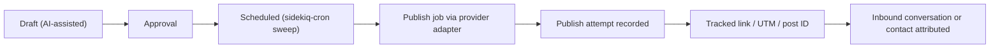

# GlintReach Architecture (Phase 00 baseline)

GlintReach is an AI-assisted campaign management product built **inside** this Chatwoot fork.
This document records the verified state of the fork at the start of GlintReach work and the
proposed architecture. Items marked **Proposed** are not implemented yet.

## 1. Repository baseline (verified 2026-10-25)

| Item | Value | Source |
| --- | --- | --- |
| Fork remote | `git@github.com:aborade-glintsys/chatwoot.git` | `git remote -v` |
| Branch | `develop` | `git branch` |
| Base commit | `3564ec1e` – "Merge branch 'release/4.19.1' into develop" (2026-10-24) | `git log` |
| Chatwoot version | 4.19.1 (no git tags in clone) | `VERSION_CW`, `package.json`, `config/app.yml` |
| Ruby | 3.4.4 | `.ruby-version` |
| Rails | 7.2.3.1 (schema format `ActiveRecord::Schema[7.1]`, version `2026_10_19_143116`) | `Gemfile.lock`, `db/schema.rb` |
| Node / pnpm | Node 24.x (`.nvmrc` 24.22.1), pnpm 10.x (`pnpm@10.2.0`) | `package.json` |
| Frontend | Vue 3.5, vue-router 4.4, Vuex 4.1 + Pinia 3, Vite 6.4.2, Tailwind 3.4, Vitest 3.0.5, ESLint 8 | `package.json` |
| Database | PostgreSQL 16 with pgvector (`pgvector/pgvector:pg16`) | `docker-compose.yaml` |
| Jobs | Sidekiq 7.3.10 + sidekiq-cron 2.4.0, Redis | `Gemfile.lock`, `config/sidekiq.yml`, `config/schedule.yml` |
| Auth / authz | Devise + devise_token_auth 1.2.5, Pundit 2.3.0 | `Gemfile.lock` |
| AI libs | `ruby_llm` 2.0.0, `ruby-openai` 7.3.1, model routing via `config/llm.yml` + `Llm::FeatureRouter` | `Gemfile.lock`, `AGENTS.md` |
| Social libs | `koala` 3.4.0 (Facebook Graph) | `Gemfile.lock` |
| Agent instructions | `AGENTS.md` (= `CLAUDE.md`), `.windsurf/rules/chatwoot.md`, workspace `../AGENTS.md` | repo |

## 2. Existing architecture (as found)

### Accounts and users
- `Account` is the tenant. `User` joins accounts via `AccountUser` (roles `administrator` / `agent`;
  Enterprise adds `CustomRole`).
- `Current.account`, `Current.user`, `Current.account_user` hold request context.

### Account scoping and authorization
- Account APIs live under `/api/v1/accounts/:account_id/...` and inherit
  `Api::V1::Accounts::BaseController`, which runs `EnsureCurrentAccountHelper#current_account`.
  That verifies the user (or agent bot) actually belongs to the account – the URL account ID is never
  trusted on its own.
- Records are loaded through the account association (`Current.account.campaigns.find_by!(...)`).
- Pundit policies in `app/policies` (`ApplicationPolicy` receives the `account_user`); controllers
  call `authorize`/`check_authorization`.
- Access-token API calls require the `api_and_webhooks` feature (`validate_token_api_access`) and MFA
  enforcement.

### Routes, controllers, serializers
- `config/routes.rb`: `namespace :api, defaults: { format: 'json' }` → `v1`, `v2`; public APIs separate.
- Responses use **Jbuilder** views in `app/views/api/v1/accounts/<resource>/`.
- Validation errors return 422; custom exceptions in `lib/custom_exceptions/`.
- Swagger docs in `swagger/`.

### Enterprise overlay
- `enterprise/` (separately licensed) extends OSS code with `prepend_mod_with` / `include_mod_with`.
  Specs mirror under `spec/enterprise`.

### Frontend
- Dashboard SPA: `app/javascript/dashboard` – routes under `routes/dashboard/**/X.routes.js` with
  `meta.featureFlag` and `meta.permissions`; API clients in `api/` extend `ApiClient`; state in
  Vuex `store/modules` (legacy) and Pinia `stores/`.
- New UI should use `components-next/`, Composition API with `<script setup>`, Tailwind utility
  classes only (no custom/scoped CSS), i18n strings in `en.json` (backend `en.yml`).

### Background jobs and scheduling
- Sidekiq queues defined in `config/sidekiq.yml` (`critical` … `scheduled_jobs`, `low`, `purgable`…).
- Cron via sidekiq-cron in `config/schedule.yml` (validated by `spec/configs/schedule_spec.rb`).

### File storage
- Active Storage with `local`, `amazon`, `google`, `microsoft`, `s3_compatible` services
  (`config/storage.yml`), selected by env.

### Feature flags
- `config/features.yml` + `Featurable` concern, bitset on `accounts.feature_flags` (**full, 63/63**)
  and `feature_flags_ext_1`. New flags **must** use `column: feature_flags_ext_1` and be appended.
- Frontend mirror: `app/javascript/dashboard/featureFlags.js`.

### Audit, encryption and secrets
- Audit logs: `audited` gem, Enterprise `Enterprise::AuditLog` and `enterprise/app/models/enterprise/audit/*`.
- Encryption: Active Record encryption (`encrypts :page_access_token`, `encrypts :access_token if
  Chatwoot.encryption_configured?`).
- Secrets: env vars, `InstallationConfig`/`GlobalConfig` for installation-level settings.

## 3. Naming conflict and proposed namespace

Chatwoot **already ships a `Campaign` model** (`campaigns` table; live chat / SMS / WhatsApp
outbound messaging), `CampaignPolicy`, `Api::V1::Accounts::CampaignsController`, frontend
`routes/dashboard/campaigns`, the `campaigns` and `campaign_analytics` feature flags, and Enterprise
`CampaignRecipient`. Using `Campaigns` as the GlintReach namespace would collide.

**Proposed:** bounded namespace `GlintReach` (compact style per `AGENTS.md`):

| Layer | Location |
| --- | --- |
| Models | `app/models/glint_reach/*.rb`, tables prefixed `glint_reach_` |
| Services | `app/services/glint_reach/**` |
| Jobs | `app/jobs/glint_reach/**` |
| Policies | `app/policies/glint_reach/*_policy.rb` |
| Controllers | `app/controllers/api/v1/accounts/glint_reach/*` → `/api/v1/accounts/:account_id/glint_reach/...` |
| Views | `app/views/api/v1/accounts/glint_reach/**` (Jbuilder) |
| Frontend | `routes/dashboard/glintReach/`, `api/glintReach/`, Pinia `stores/glintReach/`, `components-next/GlintReach/` |
| i18n | `GLINT_REACH` key in `en.json`, `glint_reach` in `en.yml` |
| Feature flag | `glint_reach` (`column: feature_flags_ext_1`, `enabled: false`) |
| Specs | mirror paths under `spec/` |

## 4. Product goals and scope (Proposed)
- Plan, generate (AI-assisted), approve, schedule and publish social/marketing campaign content
  per Chatwoot account.
- Attribute inbound conversations/contacts back to the campaign posts that produced them, reusing
  Chatwoot inboxes and contacts.
- Out of scope until approved: separate services/frontends, replacing existing Chatwoot campaigns.

## 5. Integration boundaries
- GlintReach **reads** Chatwoot accounts, users, inboxes, contacts and conversations; it does not
  change their behavior or schemas, except through additive, opt-in extension points.
- Everything is hidden and inert while the `glint_reach` feature flag is off.
- No changes to existing campaign tables/APIs.

## 6. Proposed domain architecture
- Core records (later phases): brand profile, campaign, content item / post variant, schedule,
  social connection, publish attempt, attribution link/event.
- Service objects for workflows (generation, approval, publishing), Sidekiq jobs for async/external
  calls, Jbuilder serializers, Pundit policies.

## 7. Tenant isolation principles
- Every GlintReach table has `account_id NOT NULL` + index; queries start from `Current.account`.
- Jobs receive primitive IDs and re-load through the account.
- Policies check `account_user` role; never accept `account_id` from params bodies.
- Specs include cross-account access attempts (expect 404/401).

## 8. AI and social provider boundaries
- AI calls go through existing `ruby_llm` / `config/llm.yml` / `Llm::FeatureRouter`; no hard-coded
  model names; keys server-side only.
- Social providers behind a `GlintReach::Providers::<Name>` adapter interface; OAuth tokens stored
  with `encrypts`, never serialized to the frontend or logs.
- No provider integration is added without verified API access and credentials.

## 9. Publishing and attribution flow (Proposed)


## 10. Development and test commands
From `AGENTS.md` and `package.json` (requires Ruby 3.4.4 via rbenv, Node 24, pnpm 10,
PostgreSQL 16 + pgvector, Redis):

```bash
eval "$(rbenv init -)"
bundle install && pnpm install
bundle exec rails db:create db:schema:load   # or db:prepare
bundle exec rails db:seed
pnpm dev                                      # overmind start -f ./Procfile.dev
bundle exec rspec spec/path/to/file_spec.rb
bundle exec rubocop
pnpm test                                     # vitest
pnpm eslint
```
Migrations: `bundle exec rails g migration <Name>` (real timestamps; CI checks via
`migration_version_check.yml`).

## 11. Baseline check results (Phase 00)

| Check | Result |
| --- | --- |
| Working tree | Clean on `develop` at `3564ec1e` |
| `bundle exec rspec` | **Not run** – Ruby 3.4.4 not installed (`~/.rbenv/versions` absent; only system Ruby 3.0) |
| `bundle exec rubocop` | **Not run** – same reason |
| `pnpm test` / `pnpm eslint` / build | **Not run** – Node and pnpm not installed |
| PostgreSQL / Redis | Clients present (psql 16.15, redis 6.0.16); servers not reachable from the agent sandbox |

## 12. Licensing and fork maintenance
- OSS code: MIT Expat (© Chatwoot Inc.). `enterprise/` is under `enterprise/LICENSE` (separate,
  commercial terms) – GlintReach code must live outside `enterprise/` unless that license is cleared.
- Keep GlintReach additive and namespaced to ease upstream merges; prefer extension points over
  editing upstream files; Conventional Commits; only `en.yml`/`en.json` for new strings.

## 13. Unresolved decisions
See `implementation-roadmap.md` § Decisions.
